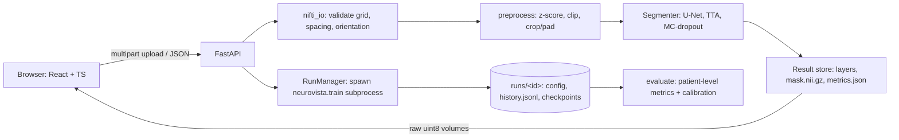

# Architecture

## Key decisions

- **One preprocessing path.** `neurovista/preprocess.py` is imported by training (`data.preprocess_dataset`), evaluation and inference. A test asserts the inference path equals the training normalisation. Brain-mask z-score (voxels > 0) after 0.5–99.5 percentile clipping; label 4 → 3.
- **Grid handling.** In-plane grids are cropped to 192² only when that discards no non-zero voxel (BraTS 240² has empty borders); otherwise padded to a multiple of 16. Predictions are restored to the original grid, so output masks keep the input affine exactly.
- **Rejection over guessing.** Mismatched shapes/affines, non-axial third axes, empty/NaN volumes and unreadable files are rejected with stable error codes; no silent resampling.
- **Model.** 2D slice-wise U-Net (guide §6): 4 input channels, 4 classes, configurable base width, `Dropout2d` in the deepest blocks (enables MC-dropout), optional attention gates. Checkpoints are loaded with `torch.load(weights_only=True)` and validated against their declared architecture.
- **Viewer data path.** The backend reorients every layer to RAS and returns raw `uint8` volumes (T1/T1ce/T2/FLAIR windowed for display, labels, confidence, uncertainty). The browser slices them in any plane, so axial/coronal/sagittal views stay synchronised with no round trips, and canvas size follows physical voxel spacing (no distortion). Display windowing is for visualisation only; metrics use the model's own tensors.
- **No database.** Jobs are directories with a `meta.json` and a TTL; training runs are directories with JSON/JSONL files. This keeps retention auditable and avoids storing medical data in a DB.
- **Training as a subprocess.** The API never trains in-process: cancellation is a file flag, a crashed process is detected and reported as failed, and the API stays responsive.
- **Concurrency.** One inference at a time (semaphore) to bound memory; extra requests get `429 busy`.
