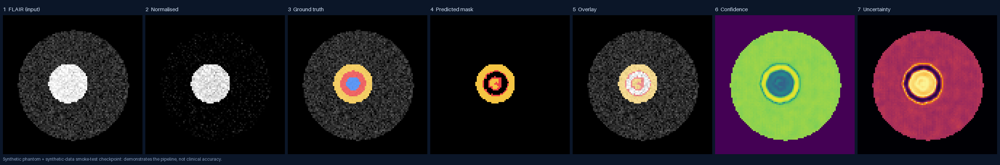
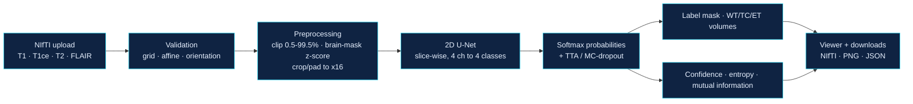
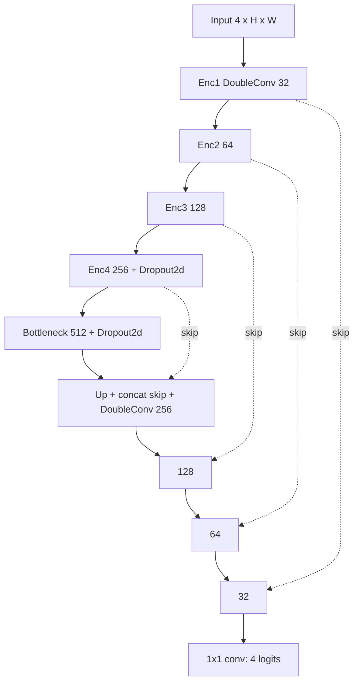

<div align="center">



**Automated medical image segmentation with calibrated confidence and uncertainty — from NIfTI upload to an interactive multi-planar viewer.**


[Overview](#overview) · [Workflow](#medical-imaging-workflow) · [Architecture](#system-architecture) · [Methodology](#segmentation-methodology) · [Results](#results-and-visualizations) · [Installation](#installation-and-setup) · [Future work](#future-improvements)

</div>

> **Research prototype only.** This software has not been validated for clinical use and must not be used for diagnosis, treatment decisions, or patient management. Outputs require qualified review.

---

## Overview

NeuroVista AI is an end-to-end engineering and research project for **brain tumor sub-region segmentation** on BraTS-style multi-modal MRI (T1, T1ce, T2, FLAIR). It covers the whole path: reproducible preprocessing and patient-wise splits, a trainable PyTorch U-Net, volume-level evaluation, test-time augmentation and Monte-Carlo dropout for uncertainty, a FastAPI service, and a React workspace with a medical-style viewer.

**Scope, stated plainly**

| Item | State |
|---|---|
| Segmentation (U-Net / Attention U-Net, 4 classes) | Implemented, unit- and API-tested |
| Classification (e.g. tumor type) | **Not implemented.** The repository contains no classifier; none is claimed |
| Training on real BraTS data | **Not performed** — dataset and GPU not bundled |
| Measured accuracy on real patients | **None.** No Dice / IoU / HD95 for real data exists in this repo |
| 3D model, Docker build, hosted deployment | Not implemented / not verified |

## Key features

- **Four-channel 2D U-Net** (plus optional attention gates), Dice + cross-entropy loss, AdamW, cosine schedule, AMP, gradient clipping, early stopping, resumable checkpoints.
- **Strict input validation**: four co-registered NIfTI volumes; shape, affine, orientation, NaN and empty-volume checks; PNG/JPG rejected with an explanation.
- **Patient-wise splits** with a persisted, seeded manifest and a leakage test.
- **Confidence & uncertainty**: max-softmax confidence, region/scan summaries, predictive entropy, MC-dropout mutual information, horizontal-flip TTA, reliability diagram, ECE and Brier score.
- **Volume-level metrics**: Dice, IoU, sensitivity, specificity, HD95 in millimetres, volume error.
- **Interactive viewer**: axial/coronal/sagittal, synchronised crosshair, opacity, per-region toggles, boundaries, heatmaps, voxel-spacing-correct aspect ratio.
- **Privacy by default**: uploads deleted right after inference; derived results expire after a retention window.

## Medical imaging workflow

<div align="center">

</div>

*Figure — real output of this pipeline on a **synthetic phantom** (`samples/SYNTHETIC_PHANTOM_2`) using a checkpoint trained on synthetic phantoms as a smoke test. It shows what each stage produces; it is **not** a patient scan and **not** evidence of segmentation accuracy (the imperfect prediction in panel 4 is genuine). Regenerate with `scripts/make_readme_figures.py`.*

<div align="center">

</div>

*Animated: predicted overlay across all axial slices of the same phantom.*

## System architecture



| Stage | Responsibility | Code |
|---|---|---|
| Validation | Reject incompatible or corrupt input before any compute | `backend/neurovista/nifti_io.py` |
| Preprocessing | One shared path for training and inference | `preprocess.py` |
| Model | U-Net / Attention U-Net | `model.py` |
| Inference | Batched prediction, TTA, MC-dropout, summaries | `inference.py` |
| Evaluation | Patient-level metrics, calibration | `metrics.py`, `evaluate.py` |
| API / UI | Upload, results, training control | `api/main.py`, `frontend/src` |

There is no separate classification stage: the system output is the segmentation, its derived volumes and its reliability maps. More detail in [ARCHITECTURE.md](ARCHITECTURE.md).

### Model architecture



DoubleConv = (3x3 Conv-BatchNorm-ReLU) x 2; base width 32 gives about 7.8 M parameters. Optional additive attention gates act on each skip connection (`attention=True`).

## Segmentation methodology

- **Classes:** background, necrotic/non-enhancing core, edema, enhancing tumor (BraTS label 4 remapped to 3). Reported regions: WT = {1,2,3}, TC = {1,3}, ET = {3}.
- **Loss:** 0.5 · cross-entropy + 0.5 · soft Dice over foreground classes (alternatives: Dice, Focal Tversky, weighted CE).
- **Post-processing:** optional removal of small 3D components (off by default; removed components are reported).
- **Volumes:** voxel count × header voxel volume, in mL.

## Classification methodology

Not implemented. Adding a tumor-type classifier on top of the predicted mask is listed under [future improvements](#future-improvements).

## Dataset and preprocessing

Expected: BraTS-style cases (`<id>_t1/t1ce/t2/flair/seg.nii.gz`), skull-stripped and co-registered. Per modality: percentile clipping (0.5–99.5), z-score inside the brain mask, background set to 0; in-plane crop 240→192 only when lossless; every tumor slice plus ~10 % empty slices for 2D training. No dataset is included — see [DATASET_GUIDE.md](DATASET_GUIDE.md) for sources and licences.

## Model training and evaluation

```bash
cd backend
python -m neurovista.cli prepare --name brats            # raw cases in var/datasets/brats/raw
# start/monitor training from the UI (Training lab) or POST /training/runs
python -m neurovista.evaluate --checkpoint var/runs/<id>/checkpoints/best.pt \
  --raw-dir var/datasets/brats/raw --processed-dir var/datasets/brats/processed --split val --out eval_val.json
```

Thresholds are derived on validation data only; the test split is evaluated once. Full details: [TRAINING_GUIDE.md](TRAINING_GUIDE.md).

## Results and visualizations

**Real-data results: none yet.** The table is intentionally empty until measured.

| Split | Patients | Dice WT | Dice TC | Dice ET | HD95 WT (mm) | ECE |
|---|---|---|---|---|---|---|
| Test (BraTS) | — | — | — | — | — | — |

Only measurement that exists in this repository: a 6-epoch CPU **smoke-test** run on 14 synthetic phantoms reached a mean validation Dice of 0.77 (WT/TC/ET) on 2 phantom volumes. That verifies the training loop runs; it says nothing about real MRI.

<div align="center">

| Dashboard | Viewer (overlay) | Multi-planar + uncertainty |
|---|---|---|
|  |  |  |

</div>

## Technology stack

| Role | Tools |
|---|---|
| Language | Python 3.11, TypeScript |
| Deep learning | PyTorch |
| Medical imaging & processing | nibabel, NumPy, SciPy, Pillow |
| API | FastAPI, Uvicorn, Pydantic, slowapi |
| Frontend & visualisation | React 18, Vite, Tailwind CSS, Recharts, canvas renderer |
| Quality | pytest, Ruff, Vitest, Testing Library, ESLint |
| Packaging | Docker / Compose (written, not yet built) |

## Project structure

```
.
├── backend/
│   ├── neurovista/        preprocess · model · losses · metrics · data · train · evaluate · inference · checkpoint · nifti_io · synthetic · cli
│   │   └── api/           main (FastAPI) · store (results, TTL) · runs (training/experiments)
│   ├── tests/             47 pytest tests
│   └── Dockerfile, requirements*.txt, pyproject.toml
├── frontend/              React + TypeScript workspace (pages, viewer, typed API client)
├── samples/               two synthetic phantoms for demos
├── scripts/make_readme_figures.py   regenerates docs/figures from real model output
├── docs/figures, docs/screenshots   README assets
└── ARCHITECTURE · API_DOCUMENTATION · MODEL_CARD · TRAINING_GUIDE · DEPLOYMENT · DATASET_GUIDE · TESTING (.md)
```

## Installation and setup

Prerequisites: Python 3.11, Node 20+. A GPU is optional (CPU works for inference and smoke tests).

```bash
cd backend
python -m venv .venv && source .venv/bin/activate        # Windows: .venv\Scripts\activate
pip install torch --index-url https://download.pytorch.org/whl/cpu
pip install -r requirements-dev.txt
uvicorn neurovista.api.main:app --port 8000               # starts even without a checkpoint

cd ../frontend && npm install && npm run dev               # http://localhost:5173
```

Model weights are **not** in the repository (`*.pt` is git-ignored). Provide `var/checkpoints/best.pt` (or set `NV_CHECKPOINT_PATH`) or train one. Configuration reference: `.env.example`.

## Usage and inference

1. Open the workspace → **New segmentation**, drop the four NIfTI files (try `samples/SYNTHETIC_PHANTOM_1/`), start.
2. Inspect slices, regions, confidence and uncertainty; download the mask, PNG and metrics JSON.
3. Optionally upload a ground-truth label volume to measure Dice/HD95 for that scan.

CLI: `python -m neurovista.cli predict --t1 … --t1ce … --t2 … --flair … --out out/` · API: [API_DOCUMENTATION.md](API_DOCUMENTATION.md).

Smoke test without data: `python -m neurovista.cli synth --name synthetic` then train from the UI and mark the dataset synthetic.

## Example output

`metrics.json` / API response fields: per-region voxels, `volume_ml`, `confidence`, `confidence_level`, `mean_uncertainty`; `scan_confidence`; inference time; checkpoint provenance (including a `synthetic` flag). The NIfTI mask keeps the input affine and uses BraTS labels 0/1/2/4.

## Limitations and responsible medical AI use

- Not a medical device; no clinical validation, regulatory approval, diagnosis, prognosis or treatment advice.
- Softmax confidence is a model score, not a guarantee; thresholds are only meaningful after validation-set calibration.
- Expects skull-stripped, co-registered axial BraTS-style input; no resampling or registration is performed.
- 2D slice-wise model without through-plane context; behaviour on other populations or protocols is unknown.
- Use de-identified data only; respect dataset licences. See [MODEL_CARD.md](MODEL_CARD.md).

## Future improvements

- Train and report on BraTS (test split, patient-level, multiple seeds).
- 3D / nnU-Net-style baseline and Attention U-Net ablation results.
- Tumor-type **classification** head or second-stage classifier (not present today).
- Verified Docker images, authentication for public hosting, ONNX export.

## Research references

- Ronneberger, Fischer, Brox. *U-Net: Convolutional Networks for Biomedical Image Segmentation.* MICCAI 2015.
- Oktay et al. *Attention U-Net: Learning Where to Look for the Pancreas.* 2018.
- Isensee et al. *nnU-Net: a self-configuring method for deep learning-based biomedical image segmentation.* Nature Methods 2021.
- Menze et al. *The Multimodal Brain Tumor Image Segmentation Benchmark (BRATS).* IEEE TMI 2015.
- Gal, Ghahramani. *Dropout as a Bayesian Approximation.* ICML 2016.
- Guo et al. *On Calibration of Modern Neural Networks.* ICML 2017.

## Author

**Ruchira Chowdary** — final-year B.Tech (AI & ML) project · GitHub [@ruchirachowdary-1836](https://github.com/ruchirachowdary-1836)

Issues and suggestions are welcome via the repository's issue tracker. No licence file is present yet; all rights reserved until one is added.
