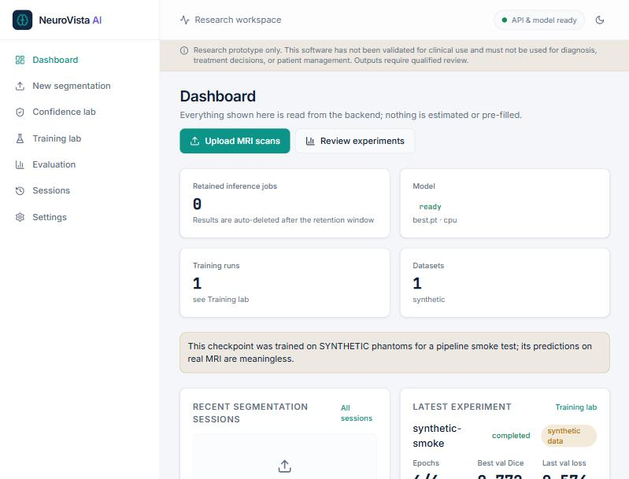
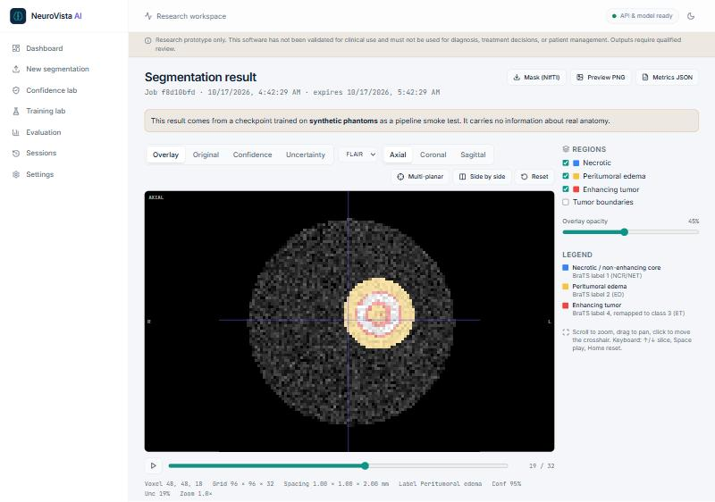
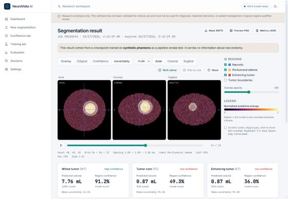

# NeuroVista AI — Brain Tumor Segmentation Research Platform

> **Research prototype only.** This software has not been validated for clinical use and must not be used for diagnosis, treatment decisions, or patient management. Outputs require qualified review.

End-to-end platform for multi-modal brain MRI tumor segmentation (BraTS-style T1 / T1ce / T2 / FLAIR): a trainable PyTorch U-Net pipeline, a FastAPI service, and a React/TypeScript workspace with an interactive multi-planar viewer, confidence and uncertainty analysis, a training lab and evaluation tooling. It follows the technical specification in `Brain_Tumor_Segmentation_Build_Guide.pdf`.

| Dashboard | Viewer (overlay) | Multi-planar + uncertainty |
|---|---|---|
|  |  |  |

*Screenshots show a **synthetic phantom** processed by a checkpoint trained on synthetic data for a pipeline smoke test. They demonstrate the software, not segmentation quality.*

## Status — what is and is not true today

| Capability | Status |
|---|---|
| U-Net / Attention U-Net, losses, metrics, preprocessing, dataset, training loop, inference, API, UI | **Implemented and tested** (see [TESTING.md](TESTING.md)) |
| End-to-end flow on synthetic phantoms (upload → inference → viewer → downloads → ground-truth comparison) | **Executed and verified locally** |
| Training on real BraTS data | **Not done** — dataset and compute are not bundled. No trained clinical model exists in this repo |
| Measured accuracy on real data | **None.** No Dice/HD95 figure for real patients is claimed anywhere |
| 3D U-Net (experiment 7) | **Not implemented** (reported as such in the UI) |
| Docker images / hosted deployment | **Config written, not built or verified** (Docker was unavailable in the build environment) |

## Quick start

```bash
# backend (Python 3.11)
cd backend
python -m venv .venv && source .venv/bin/activate      # Windows: .venv\Scripts\activate
pip install torch --index-url https://download.pytorch.org/whl/cpu
pip install -r requirements-dev.txt
uvicorn neurovista.api.main:app --port 8000

# frontend (Node 20+)
cd frontend
npm install
npm run dev                                            # http://localhost:5173
```

The backend starts without a checkpoint; `/ready` reports `503` and the UI explains what is missing.

### Try the pipeline without real data (smoke test only)

```bash
cd backend
python -m neurovista.cli synth --name synthetic --n 14      # synthetic phantoms, NOT MRI
# then in the UI: Training lab → dataset "synthetic" → tick "synthetic" → Start → "Use for inference"
```

Two phantom cases for upload testing are in [`samples/`](samples) (each folder holds `_t1/_t1ce/_t2/_flair` and a `_seg` ground truth).

### Real data

See [DATASET_GUIDE.md](DATASET_GUIDE.md) and [TRAINING_GUIDE.md](TRAINING_GUIDE.md). A GPU is strongly recommended for BraTS-scale training.

## Repository layout

```
backend/neurovista/   preprocess, model, losses, metrics, data, train, evaluate, inference, checkpoint, nifti_io, synthetic, cli
backend/neurovista/api/   FastAPI app (main), result store, training/experiment manager
backend/tests/        pytest suite
frontend/src/         pages, viewer, typed API client, design tokens
samples/              synthetic phantoms for demos
```

## Documentation

[ARCHITECTURE](ARCHITECTURE.md) · [API](API_DOCUMENTATION.md) · [MODEL CARD](MODEL_CARD.md) · [TRAINING](TRAINING_GUIDE.md) · [DEPLOYMENT](DEPLOYMENT.md) · [DATASETS](DATASET_GUIDE.md) · [TESTING](TESTING.md)

## Privacy

Uploaded scans are written to a temporary directory and deleted as soon as inference ends. Only derived results (display layers, mask, metrics) are kept, for `NV_ARTIFACT_TTL_MINUTES` (default 60), then deleted. Use de-identified data only. No database is used.
